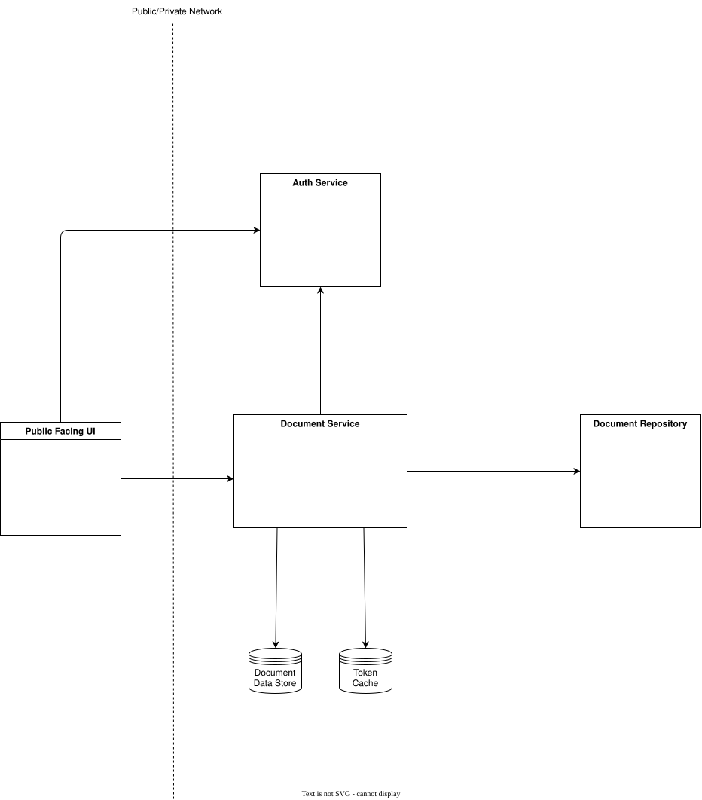

# Dev Documentation

This project is build to offer a system to store customer account statements as PDF files and provide secure, time-limited download links to customers.  

The projects main aim is to showcase and highlight extense of knowledge and experience related to enterprise systems desing and implementation.

## Overview
The implemantation was carried out following the steps outlined below
1. [Tools Used][#tools-used]
2. [System Design](#system-design)
3. [Scafolding](#scaffolding) and basic implementations of services

## Tools Used
- IDE: VSCode was used entrirely for this project
- AI: Copilot non paid agent was used for scafolding and other tasks 

## System Design

## Scaffolding
### UI
### Auth service
Using Keycloak for our auth service and following these [instructions](https://www.keycloak.org/getting-started/getting-started-docker) a new realm and client was created with the named `file-delivery` and `file-delivery-ui`.

Have set all redirect and CORS settting to * to avoid failure.  Should change them and make them specific to the eventual environment.
### S3 Service
Set up following this Docker (image)[https://hub.docker.com/r/luofuxiang/local-s3]
